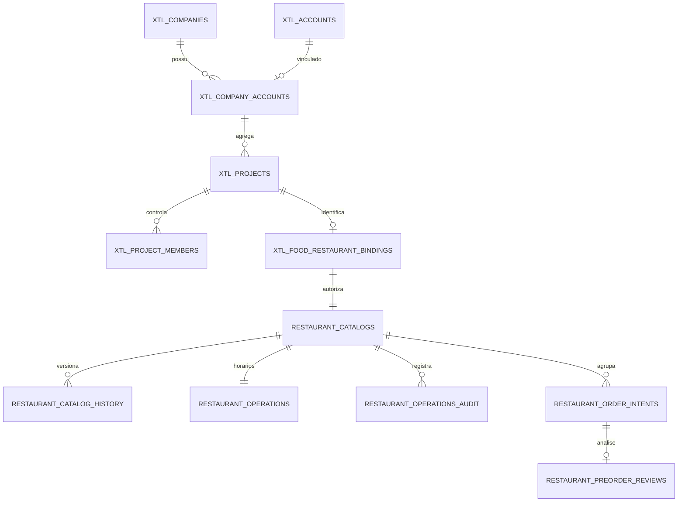

# Banco XTL — empresas, projetos e Food
## Mapa lógico das tabelas
Diagrama baseado nas tabelas atualmente verificadas em `xtl-core-id-lab`.

## Responsabilidades
| Tabela | Finalidade | Dados sensíveis | Estado verificado |
| --- | --- | --- | --- |
| `xtl_companies` | Pessoas jurídicas e marcas do grupo | Cadastro empresarial | 3 empresas |
| `xtl_projects` | Projetos vinculados a uma conta e empresa | Não | 4 projetos |
| `xtl_food_restaurant_bindings` | Vincula o restaurante ao projeto correto | Interno | 1 vínculo |
| `restaurant_catalogs` | JSON completo do cardápio | Público | 12 categorias, 82 produtos |
| `restaurant_catalog_history` | Versões anteriores | Comercial | Vazia |
| `restaurant_operations` | Horários, abertura/fechamento | Administrativo | 1 configuração, horários reais não definidos |
| `restaurant_operations_audit` | Histórico administrativo | Restrito | Vazia |
| `restaurant_order_intents` | Idempotência e entrega ao Telegram | Restrito | Sem pedidos reais |
| `restaurant_preorder_reviews` | Contatos, itens, aprovação ou rejeição | **Pessoal** | Sem pedidos reais |
## Segurança
- `xtl_food_runtime` é NOLOGIN e tem permissões apenas nas tabelas operacionais Food, sem acesso a XTL ID ou LinkSul.
- O catálogo pode ser lido publicamente; pedidos, status e auditorias exigem rotas autenticadas e privilégios mínimos.
- A validação completa de acesso usando conexão real da conta de aplicativo ainda falta; testes no conector administrativo não puderam assumir esse papel.
- Em 17/11/2026, foram criados quatro índices de relações Food/empresa/projeto; alertas de FK sem índice passaram de 9 para 5.
- A Vercel não aceitou variáveis somente para a branch porque o projeto `opanquecao` não está vinculado ao Git nas configurações. Nenhuma variável foi criada.
## O que falta para uso em produção
Credenciais Food de acesso mínimo, driver de banco parametrizado, bot Telegram isolado para testes, backoffice administrativo, notificações opt-in, backup e validação E2E. Não ativar chaves globais em aplicação de empresa.
